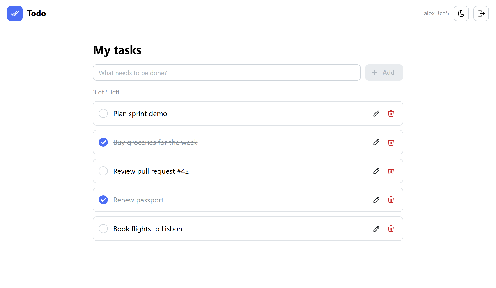
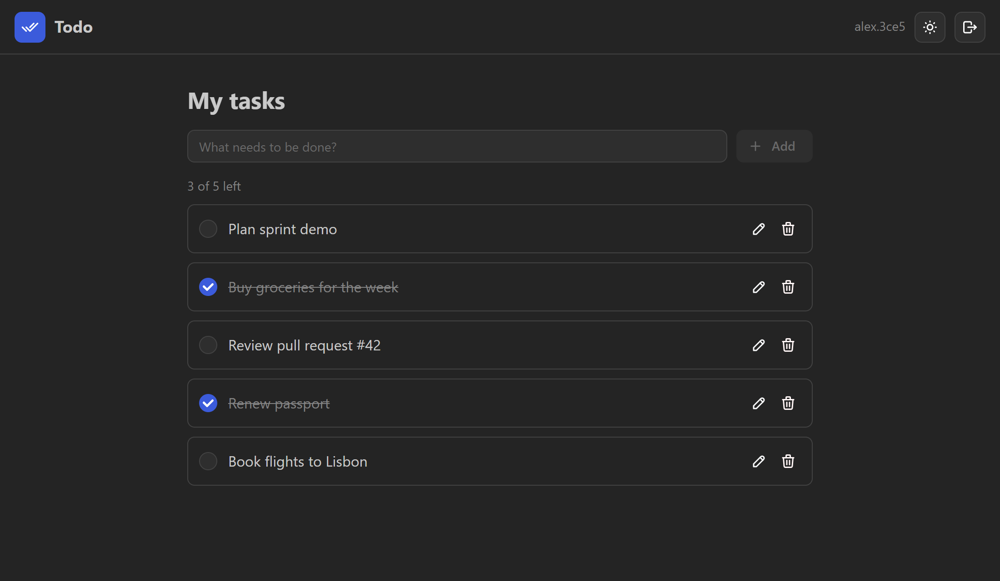

# Todo

A full-stack task manager: create, edit, complete and delete your tasks. Light and dark themes, works on mobile.

No sign-up wall: you start as a **guest** and can use everything immediately. When you sign up, the guest account is upgraded in place, so your tasks come with you.

**Live demo: [full-stack-todo-delta.vercel.app](https://full-stack-todo-delta.vercel.app)**

The point of the project is less the feature set than **how it's built**. The backend follows **Clean / Onion architecture**, the frontend follows **Feature-Sliced Design**, and automated checks enforce both, so the rules can't quietly erode.

<p align="center">
  
  
</p>

## Stack

| | |
|---|---|
| **Frontend** | React 19, TypeScript, Vite, Mantine 9, TanStack Query 5 |
| **Backend** | Node.js 24, Express 5, TypeScript, Zod |
| **Database** | PostgreSQL, Prisma 7 |
| **Auth** | JWT in an httpOnly cookie, bcrypt |
| **Quality** | `node:test` API and architecture tests, Steiger (FSD linter), strict TypeScript |
| **Hosting** | Vercel (static client + serverless API), Neon Postgres |

## Architecture

### Backend: Clean / Onion

```
server/src/
├── domain/           Entities, business rules, repository interfaces. No dependencies at all.
├── application/      Use cases (AuthService, TodoService) and the ports they need.
├── infrastructure/   Adapters: Prisma repositories, bcrypt, JWT, env config.
├── presentation/     HTTP: Express routes, Zod request schemas, cookie auth, error mapping.
└── main/             Composition root: builds the object graph and wires the layers together.
```

**Dependency rule:** imports only point inward.

```
main ──▶ presentation ──▶ application ──▶ domain
   └───▶ infrastructure ──┘
```

- `domain` imports nothing: no packages, no other layers.
- `application` imports only `domain`. It has no Express, no Prisma and no npm packages.
- `presentation` never touches `infrastructure`. It only sees use cases and domain errors.
- `infrastructure` implements the interfaces defined by the inner layers. Prisma errors are translated into domain errors there and never leak upward.

[`architecture.test.ts`](server/src/architecture.test.ts) enforces this by scanning every import and failing the test suite on a violation.

Business rules live in the inner layers. For example, a user can only touch their own todos: repositories scope every query by owner, and `TodoService` turns "not yours" into a `NotFoundError`, so the API never reveals that another user's todo exists.

### Frontend: Feature-Sliced Design

```
client/src/
├── app/        Entry point, providers, theme, query-client policy
├── pages/      todos
├── widgets/    header, todo-list
├── features/   auth, theme-toggle, todo-create, todo-edit, todo-toggle, todo-delete
├── entities/   session, todo         (API calls, query keys, types, presentational UI)
└── shared/     api                   (typed fetch wrapper)
```

- A layer imports only from layers below it: `app → pages → widgets → features → entities → shared`.
- Slices on the same layer never import each other. `widgets/todo-list` composes `todo-toggle`, `todo-edit` and `todo-delete` instead.
- Each slice exposes a public API through its `index.ts`; nothing reaches into another slice's internals.
- Features own the mutations (one user action each). Entities own the data shape and cache keys.

[Steiger](https://github.com/feature-sliced/steiger), the official FSD linter, enforces this: `npm run lint:arch`.

## Security

- **Auth:** a JWT (HS256, 7 days) is stored in an `httpOnly`, `Secure`, `SameSite=Lax` cookie, so JavaScript can't read it and an XSS bug can't steal it. Nothing is kept in `localStorage`.
- **Authorization:** every todo query is scoped to its owner. A test checks that user B gets `404` when touching user A's todos.
- **Guests** are ordinary users without credentials, so they get exactly the same isolation. An upgrade only ever applies to a guest account (`WHERE login IS NULL`), never to an existing account, and choosing a login that's already taken is rejected.
- **Passwords** are hashed with bcrypt (cost 12). Login returns the same error for an unknown user and a wrong password.
- **Validation:** every request body and URL parameter is parsed with Zod at the HTTP boundary. Bodies are limited to 10 KB.
- **Rate limiting** applies to sign-in and sign-up.
- **No secrets in the repo:** configuration comes from environment variables and is validated at startup.
- **Errors:** clients get clean error messages; stack traces and internals are logged only on the server.
- **Headers:** Content-Security-Policy, `X-Content-Type-Options`, `Referrer-Policy` and `frame-ancestors 'none'` (see [`vercel.json`](vercel.json)).

## API

| Method | Path | |
|---|---|---|
| `POST` | `/api/auth/guest` | `201 { login: null, isGuest: true }` and sets a guest session cookie |
| `POST` | `/api/auth/register` | `{ login, password }` → `201 { login, isGuest: false }`. If the caller is a guest, that account is upgraded and keeps its todos. |
| `POST` | `/api/auth/login` | `{ login, password }` → `{ login, isGuest: false }` and sets the session cookie |
| `POST` | `/api/auth/logout` | `204` and clears the cookie |
| `GET` | `/api/auth/me` | `{ login, isGuest }` or `401` |
| `GET` | `/api/todos` | The current user's todos, newest first |
| `POST` | `/api/todos` | `{ name }` → `201 Todo` |
| `PATCH` | `/api/todos/:id` | `{ name?, isDone? }` → `Todo` |
| `DELETE` | `/api/todos/:id` | `204` |

## Running locally

Requirements: Node.js 24 and Docker.

```sh
docker compose up -d                  # Postgres on localhost:5432
cp server/.env.example server/.env    # then set JWT_SECRET (the command to generate one is in the file)
npm install
npm run db:migrate -w server          # create the tables

npm run dev -w server                 # API on http://localhost:4000
npm run dev -w client                 # app on http://localhost:5173 (proxies /api to the API)
```

Checks:

```sh
npm test            # API integration tests + architecture rules (needs the database running)
npm run lint:arch   # Feature-Sliced Design rules
npm run typecheck
npm run build
```

## Deploying to Vercel

The whole app deploys as one Vercel project. The client is served as static files, and [`api/index.ts`](api/index.ts) runs the Express app as a serverless function on the same domain.

1. Import the repository in Vercel (**Add New → Project**) and keep the repository root as the root directory.
2. In the project, open **Storage → Create Database → Neon** (free tier) and connect it. This adds `DATABASE_URL` and `DATABASE_URL_UNPOOLED`.
3. Add an environment variable `JWT_SECRET` with a random value of at least 32 characters:
   `node -e "console.log(require('crypto').randomBytes(48).toString('base64url'))"`
4. Deploy. The build (`npm run vercel-build`) generates the Prisma client, applies database migrations, and builds the client.
